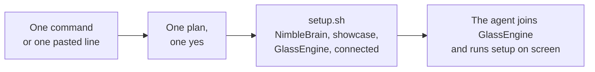

# NimbleBrain local setup

This skill gets NimbleBrain running on the person's own machine. You install it, start two example
apps, and connect the person's coding agent to them. Then you hand over. The person's agent
finishes setup inside NimbleBrain, on screen, while they watch.



Every address you use below is `127.0.0.1` or `localhost`. Work in the
open. Say what you are about to run, run it, and show what happened.

## Two ways in

| From a terminal | From a session already open |
|---|---|
| `curl -fsSL https://raw.githubusercontent.com/NimbleBrainInc/nimblebrain/main/install.sh \| bash` | Paste: **Set up NimbleBrain locally: follow https://raw.githubusercontent.com/NimbleBrainInc/nimblebrain/main/.agents/skills/nimblebrain-setup/SKILL.md** |
| Codex: add `-s -- --codex` after `bash` | Same line in Codex |

The terminal command shows the conflict report and plan, asks once, installs the plugin
(marketplace `nimblebrain`, plugin `nimblebrain`), and runs setup. It starts the agent only after
NimbleBrain, the showcase and GlassEngine are ready, then asks it to join GlassEngine and offer
the optional key step.

When you were started from the pasted line instead, install the plugin first, with the same script
and no launch: `curl -fsSL https://raw.githubusercontent.com/NimbleBrainInc/nimblebrain/main/install.sh | NB_NO_LAUNCH=1 bash`
(add `-s -- --codex` on Codex; it may need to run outside your sandbox). Then the plugin's tools
need one thing from the person, which you say in the plan:

- Claude Code: type `/reload-plugins` once setup has finished, which loads the plugin's servers
  into this session.
- Codex: has no reload. After setup, quit and run `codex resume --last`, which reopens this
  conversation with the plugin, the feature and the workspace door loaded.

Find `SCRIPTS` in the copy the agent keeps of the marketplace:
`claude plugin marketplace list --json` (`installLocation`) or `codex plugin marketplace list --json`
(`root`), plus `/.agents/skills/nimblebrain-setup/scripts`.

## Fast path

As few human steps as possible: one plan, one yes. Use the agent's own question tool for each
question (AskUserQuestion in Claude Code); otherwise ask in plain text with the options listed.

1. **Check, read-only.** Run `bash "$SCRIPTS/check.sh" --agent <claude|codex>` (add any `--dir`,
   `--repo`, `--ref` or port the person or the launch prompt gave). It changes nothing and prints
   every conflict: what it found, what it expected, and what setup will do (reuse, skip or ask).
2. **One plan, one question.** Show this, with the conflict lines under it, and ask **Go ahead?**
   with the answers **Yes** and **Change something**:

   > I will set up NimbleBrain in `~/nimblebrain` (NimbleBrain on localhost 27270, its API on
   > 27271, the showcase on 27280, GlassEngine on 27281; telemetry off). I install from the
   > lockfiles, start all three, add the showcase and GlassEngine to your workspace, connect this
   > agent to all three, put a NimbleBrain shortcut on your Desktop, and open GlassEngine for you.
   > The two connectors run on plain HTTP on localhost, so I set NimbleBrain's development setting
   > `allowInsecureRemotes`, which allows that for localhost addresses only. Anything already set up
   > is reused; I add, I never replace. NimbleBrain's own chat needs an Anthropic key, which you can
   > add after.

   For a missing tool, add its install command to the same plan, from
   [references/prerequisites.md](references/prerequisites.md) (Homebrew when `brew` exists). A
   password or sudo prompt the person types for that install is fine; the setup itself never uses
   sudo. On **Change something**, ask what, then go on
   with those values, or follow the step-by-step sections below.
3. **Run it.** `bash "$SCRIPTS/setup.sh" --agent <claude|codex>` with the same flags. It may need to
   run outside your sandbox (`git clone`, local ports). It clones or updates the checkout, installs
   dependencies once per commit, writes `.env` (it only adds missing lines), starts the showcase and
   GlassEngine and then NimbleBrain, adds both as workspace connectors, verifies, and adds this
   agent's `nimblebrain` workspace connection (Codex: and the `mcp_2026_07_28` feature), and puts a
   `NimbleBrain.webloc` shortcut with NimbleBrain's icon on the Desktop, which opens NimbleBrain in
   the default browser. Exit 3 with a line starting `ASK:` means it found a conflict and stopped:
   show that line and ask. A second
   run on a finished install says "already set up" and goes straight to the hand-over. It leaves a
   recorded checkout where it is; `--update` fast-forwards it.
4. **The key, optional.** Ask **Do you have an Anthropic API key?** with **Yes**, **No, help me get
   one** and **Later**. NimbleBrain's own chat uses it; setup through GlassEngine does not.
   - Yes: open a private Terminal window running the script, where they paste the key. The path
     goes in as an argument, never inside the script text:
     `osascript -e 'on run argv' -e 'tell application "Terminal" to do script "bash " & quoted form of (item 1 of argv) & " --have-key"' -e 'end run' "$SCRIPTS/set-key.sh"`.
   - No: the same without `--have-key`; it opens the Anthropic Console keys page too.
   - Later: give them `bash "$SCRIPTS/set-key.sh"` to run in their own terminal any time.

   Both commands need to run outside your sandbox. If they cannot run, print the command for the
   person to run in their own terminal. Tell them never to paste the key into this chat. Check with
   `bash "$SCRIPTS/set-key.sh" --check`, which reads only whether it is saved. When it says yes,
   restart NimbleBrain (`stop.sh "$NB_DIR" --keep-examples`, then `start.sh "$NB_DIR"`) so it picks the key up. Until
   then, the web page may still list Anthropic as a provider; chat will not answer without a key.
5. **Hand over.** Open GlassEngine for the person with `open <GlassEngine URL>` (the URL is the
   `GlassEngine:` line `setup.sh` printed; `open` needs to run outside your sandbox). Then join as
   `claude` or `codex` with this plugin's `glassengine` tools and keep answering. Tell them to type
   **set me up** in your tab. For NimbleBrain's own tools in this session (for example
   `nb__set_preferences`), use `bash "$SCRIPTS/nb-tool.sh" --dir "$NB_DIR" <tool> '<json>'`; a new session has them
   as MCP tools.
   Call the showcase's `get_setup_checklist` first. It opens the existing setup MCP App in clients
   that render MCP Apps. In a terminal client, use its native questions and keep the same checklist
   visible in NimbleBrain. Do not promise an embedded screen when the client cannot render one.
6. **Finish** as in step 12 below, including the conflict lines from step 1.

What the person does: paste one command (or one line), answer **Yes** once, answer the key question,
and approve any tool prompts their agent shows. In Claude Code, the terminal command already allows
the plugin's own showcase and GlassEngine tools for that session.

## Ground rules

- Show the plan and get an OK before you change anything. Add, never replace: an existing value
  that differs is a conflict to report, not something to fix.
- Offer every machine-wide install (git, Bun, Node.js) as a command the person approves. Never use
  a flag that skips a permission prompt. Never install anything silently.
- Never ask for, read, print or store a model provider API key. The person enters it in their own
  Terminal window with `set-key.sh`, or types it into `.env` themselves. You may only check that it
  is saved (`set-key.sh --check`).
- Dev mode has no login. The `dev` adapter signs every request in as one local developer. For a
  real identity provider, see the `instance.json` page in the docs.
- Keep the checkout stock. NimbleBrain's runtime state stays in `.nimblebrain-worktree/` and
  GlassEngine's in `examples/glassengine/.glassengine/`, both inside the checkout and gitignored.
- Use the bundled scripts instead of retyping their commands. They print what they do.
- If a command fails with `Operation not permitted` inside your sandbox (`git clone`, a port check,
  `curl` to localhost, `open`), ask the person to let you rerun that one command outside the
  sandbox.
- Note anything that confused you or the person. "Improve this skill" uses that list.

Names used below:

| Name | Meaning |
|---|---|
| `NB_DIR` | The checkout folder |
| `API`, `WEB` | The two ports: the API and the web page |
| `WS` | The workspace id |
| `WORK` | `$NB_DIR/.nimblebrain-worktree` |
| `SCRIPTS` | `$NB_DIR/.agents/skills/nimblebrain-setup/scripts` (also in this skill's own folder) |

The numbered sections below are the same work step by step, for **Change something**, for a
fast path that stopped, or for an agent without the scripts.

## 1. Plan

Show this plan, adjusted to what the person asked for, and wait for an OK:

1. Check git, Bun, Node.js and free ports. Offer to install anything missing.
2. Ask a few choices: folder, ports, model provider, telemetry, which agent to connect.
3. Clone NimbleBrain, install dependencies from the lockfiles, build the app UIs.
4. You paste your provider key into `.env` yourself. I never see it.
5. Start NimbleBrain and check its API, web page and workspace MCP endpoint.
6. Start the showcase (127.0.0.1:27280) and GlassEngine (127.0.0.1:27281), and add both to your
   workspace as connectors.
7. Connect your agent to GlassEngine, the showcase and the workspace.
8. Hand over. Open NimbleBrain next to your agent and say "join GlassEngine as claude and keep
   answering". Your agent runs the rest of setup through the showcase while you watch.

## 2. Prerequisites

Run `bash "$SCRIPTS/doctor.sh" --api 27271 --web 27270`. Without the scripts, run `git --version`,
`bun --version`, `node --version` and `curl --version`.

Required:

- git;
- Bun, matching `packageManager` in `package.json`;
- Node.js 22+ (the web dev server runs on it);
- curl.

For anything missing, offer the matching command from
[references/prerequisites.md](references/prerequisites.md) and wait for a yes. Tested on macOS.
Linux, Windows and other agents are next steps, not tested.

## 3. Choices

On the fast path these are assumed; ask only on **Change something**. Ask them in one message, each
with its default, and accept "defaults". Details:
[references/choices.md](references/choices.md).

| Choice | Default |
|---|---|
| Folder for the checkout | `~/nimblebrain` (any real folder, not a symlink) |
| Route | From source (Docker: [references/docker.md](references/docker.md); no examples there) |
| Ports, API and web | 27271 and 27270 |
| Model provider | Anthropic (`ANTHROPIC_API_KEY`). Others need two config lines |
| Telemetry | Off (`NB_TELEMETRY_DISABLED=1`) |
| Agent to connect | The one running this skill (Claude Code or Codex) |

Tell the person up front:

- This is a separate local copy. A hosted NimbleBrain account does not sign in here, and nothing
  syncs between the two.
- Chat inside NimbleBrain needs their own provider key. Installing, checking and connecting their
  agent do not.

## 4. Clone and install

```bash
git clone https://github.com/NimbleBrainInc/nimblebrain.git "$NB_DIR"
bash "$NB_DIR/.agents/skills/nimblebrain-setup/scripts/install.sh" "$NB_DIR"
```

`install.sh` installs the root, `web/` and each `src/platform/*/ui` from their lockfiles, with
install scripts turned off. Then it builds the app UIs. It takes about a minute and writes only
inside `NB_DIR`.

## 5. Settings and the key

Create `$NB_DIR/.env` only if it does not exist (`setup.sh` does this, and on later runs only adds
missing non-secret lines). If it exists, do not open it. Ask whether it already holds the lines
below. Use the ports the person chose:

```bash
cat > "$NB_DIR/.env" <<'EOF'
# NimbleBrain local settings. This file is gitignored. Restart after editing.
ANTHROPIC_API_KEY=
NB_API_PORT=27271
NB_WEB_PORT=27270
NB_PUBLIC_ORIGIN=http://localhost:27271
NB_TELEMETRY_DISABLED=1
EOF
```

For the key, use step 4 of the fast path (`set-key.sh`, in the person's own Terminal window). On
Linux, `set-key.sh` writes it into `.env` with mode 600. They may skip it for now. Everything
except chat inside NimbleBrain still works: NimbleBrain starts, serves the web page, the workspace
door and connectors without a key.

## 6. Start

```bash
bash "$SCRIPTS/start.sh" "$NB_DIR"
```

`start.sh` reuses an instance this checkout already runs and stops with `ASK:` on a port anything
else holds, naming a free pair. A key saved by `set-key.sh` goes only into the environment of
the NimbleBrain processes it starts (the launcher, the API and the web dev server).
Otherwise it starts `bun run dev:worktree` in the background, logs to `$WORK/dev.log`, and waits
for the API and the web page. The person can instead run `cd "$NB_DIR" && bun run dev:worktree` in
their own terminal.

## 7. Verify

```bash
bash "$SCRIPTS/verify.sh" 27271 27270
```

`verify.sh` checks `/v1/health` and the web page. It finds the workspace id through
`GET /v1/bootstrap`, lists the workspace's tools over MCP, and calls `nb__status`.

Note the `MCP URL` line. That is the workspace endpoint, `http://localhost:<API>/mcp/<WS>`. Ask the
person to open `http://localhost:<WEB>` and confirm they see the workspace.

## 8. Install and start the examples

The two example apps live in the checkout at `examples/showcase/` and `examples/glassengine/`.
Older checkouts do not have them. In that case, say so, skip steps 9 and 11, and in step 10 add only
the workspace connection.

```bash
bash "$SCRIPTS/examples.sh" start "$NB_DIR"
```

- The showcase installs from its own lockfile, with install scripts off.
- GlassEngine has no lockfile of its own. It runs on the checkout's root dependencies, so it starts
  without an install.
- The showcase listens on `127.0.0.1:27280`, with the bearer token `local-showcase` (see the Run
  section of its README).
- GlassEngine listens on `127.0.0.1:27281`.
- Logs go to `$WORK/examples/`. `examples.sh status "$NB_DIR"` shows what is listening.

If anything here differs from an example's own README, the README's "Run" section wins.

## 9. Add both as workspace connectors

Each example's README has a section, "Connect to NimbleBrain". Follow it with this install's
values: the API port, `WS` from step 7, and `WORK` as the work directory.

NimbleBrain reads these files only at start, so stop it first:
`bash "$SCRIPTS/stop.sh" "$NB_DIR"`. That stops the examples too.

1. In `$WORK/nimblebrain.json`, merge `{ "allowInsecureRemotes": true }`. This development setting
   lets the workspace reach connectors on localhost addresses over plain HTTP. Back the file up
   first (`connect.sh` keeps a copy under `.nimblebrain-worktree/backups/`).
2. In `$WORK/workspaces/$WS/workspace.json`, append two entries to `connectors`:
   - the showcase entry from its README (URL `http://127.0.0.1:27280/mcp`);
   - the GlassEngine entry from its README (URL `http://127.0.0.1:27281/mcp`), with the token
     GlassEngine printed in its log, `$WORK/examples/glassengine.log`.
3. Start the examples first (`examples.sh start`), then NimbleBrain (`start.sh`). NimbleBrain
   connects to each connector as it starts, so the examples must already be listening. Check that
   the API log (`$WORK/dev.log`) shows `✓ showcase ready` and `✓ glassengine ready`. Showcase and
   GlassEngine now appear under Apps.

Run `verify.sh` again. Its tool count now has a `showcase__` line and a `glassengine__` line.

`connect.sh "$NB_DIR"` does steps 1 to 3 in one go, and keeps the examples running while it
restarts NimbleBrain. One restart stays: NimbleBrain reads connectors only at start, and the
workspace id exists only after the first start.

## 10. Connect the agent

The agent needs three MCP connections:

| Connection | URL | Gives the agent |
|---|---|---|
| GlassEngine | `http://127.0.0.1:27281/mcp` | Its own chat tab inside NimbleBrain |
| Showcase | `http://127.0.0.1:27280/mcp`, header `Authorization: Bearer local-showcase` | The setup tour and checklist |
| Workspace | `http://localhost:<API>/mcp/<WS>` | NimbleBrain's own tools and every connector |

The plugin already carries the first two, so with it installed, add only the workspace. The
workspace id differs on every install, which is why no plugin can carry it.

**Claude Code** (tested on macOS). Ask the person, then run:

```bash
claude mcp add --transport http --scope user nimblebrain http://localhost:27271/mcp/$WS
# Without the plugin, also:
claude mcp add --transport http --scope user glassengine http://127.0.0.1:27281/mcp
claude mcp add --transport http --scope user showcase http://127.0.0.1:27280/mcp \
  --header "Authorization: Bearer local-showcase"
claude mcp list                # expect: Connected for each
```

User scope also reaches the Code tab of the Claude Code desktop app. A running session does not
pick up new servers, so the person starts a new one.

**Codex**. The showcase and GlassEngine work on Codex's default MCP version. The workspace speaks
only MCP `2026-07-28`. Codex supports that behind a feature it still marks as under development.
Name it in the plan, in these words: "This turns on a Codex feature still marked under
development, for every project on this machine. `codex features disable mcp_2026_07_28` turns it
off again." With a yes:

```bash
codex features enable mcp_2026_07_28
codex mcp add nimblebrain --url http://localhost:27271/mcp/$WS
codex mcp list
```

With the feature on, Codex saves the name, timezone and theme with NimbleBrain's own tools, the
same as Claude Code. Fallback only: with a no, Codex still reaches the showcase and GlassEngine,
and `scripts/nb-tool.sh` still reaches NimbleBrain's tools over plain HTTP.

Without the plugin, see [references/connect-agents.md](references/connect-agents.md) for the
showcase and GlassEngine entries. The same page shows the raw HTTP shape for any other MCP client.

## 11. Hand over

If this session already has the GlassEngine tools (the plugin route), the plan's yes covers the
join. Open `http://localhost:<WEB>/w/<WS without ws_>/app/glassengine` for them with `open`
(outside your sandbox), then join as `claude` (or `codex`) yourself and keep answering. They type
**set me up** in your tab.

Otherwise, tell the person, in these words:

1. Open NimbleBrain at `http://localhost:<WEB>` and go to the GlassEngine app.
2. Open a new Claude Code session (or the desktop Code tab) beside it. Allow the GlassEngine tools
   once, so the loop runs without prompts.
3. Say: **join GlassEngine as claude and keep answering** (or run `/nimblebrain:glass-join`).
   On Codex, say: **join GlassEngine as codex and keep answering**.
4. Type **set me up** in the Claude (or Codex) tab of GlassEngine.

From here their own agent drives. It works through the showcase's Setup checklist: it asks for a
name, timezone and theme, saves each one with NimbleBrain's own tools, and opens each panel. Every
step shows on screen, and the person can press the same buttons. You stop doing terminal work
unless something fails.

## 12. Finish

Give the person a short summary:

- What changed and where: `NB_DIR` (code, `.env`, state in `.nimblebrain-worktree/` and
  `examples/glassengine/.glassengine/`), the agent's MCP entries, the Desktop shortcut, and anything
  installed on the machine. `onboarding.json` lists what setup added.
- Every conflict `check.sh` reported, and what was done about it.
- What you checked, with the command, and what you did not (for example chat, if there is no key
  yet).
- How to stop, restart, update and uninstall: [references/lifecycle.md](references/lifecycle.md).

When something fails, check [references/troubleshooting.md](references/troubleshooting.md) first.

## Improve this skill

Every install tests this skill. If anything was confusing, slow or wrong, tell the person in two or
three lines. Offer to draft the fix as an edit to this skill, with no personal details. They decide
whether to send it upstream as a pull request to NimbleBrainInc/nimblebrain. Do not open one
yourself.
