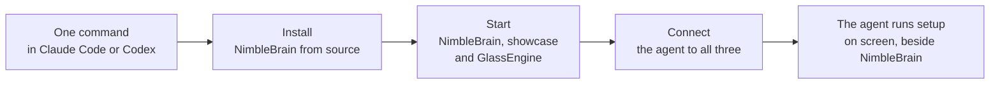

# NimbleBrain local setup

This skill gets NimbleBrain running on the person's own machine. You install it, start two example
apps, and connect the person's coding agent to them. Then you hand over. The person's agent
finishes setup inside NimbleBrain, on screen, while they watch.



You handle only what must happen before NimbleBrain is running, from the terminal. Everything
stays on this machine: every address below is `127.0.0.1` or `localhost`.

Work in the open. Say what you are about to run, run it, and show what happened.

## Install with a plugin

Each agent also has a plugin. It carries this skill, connections to the showcase and GlassEngine,
and a join command. Run one line in a terminal, then start a new session:

```bash
# Claude Code (tested on macOS)
claude plugin marketplace add NimbleBrainInc/nimblebrain && claude plugin install nimblebrain@nimblebrain
# Codex (experimental)
codex plugin marketplace add NimbleBrainInc/nimblebrain && codex plugin add nimblebrain@nimblebrain
```

Until the upstream merge, use the fork and branch named in the pull request. Put the fork in place
of `NimbleBrainInc/nimblebrain`. Add `#<branch>` to the Claude Code source and `--ref <branch>` to
the Codex one.

Each plugin points the agent at two local apps:

- the showcase, `http://127.0.0.1:27280/mcp`, with its local token `local-showcase`;
- GlassEngine, `http://127.0.0.1:27281/mcp`.

They answer once step 8 has started them. To join GlassEngine, Claude Code runs
`/nimblebrain:glass-join` and Codex uses its `glass-join` skill. To remove the plugin:
`claude plugin uninstall nimblebrain@nimblebrain` or `codex plugin remove nimblebrain@nimblebrain`.

## Ground rules

- Show the plan and get an OK before you change anything.
- Offer every machine-wide install (git, Bun, Node.js) as a command the person approves. Never use
  a flag that skips a permission prompt. Never install anything silently.
- Never ask for, read, print or store a model provider API key. The person types it into the
  checkout's `.env` themselves (git ignores that file). You may only check that the line is filled.
- Dev mode has no login. The `dev` adapter signs every request in as one local developer. For a
  real identity provider, see the `instance.json` page in the docs.
- Keep the checkout stock. All runtime state stays inside it, in `.nimblebrain-worktree/`.
- Use the bundled scripts instead of retyping their commands. They print what they do.
- If a command fails with `Operation not permitted` inside your sandbox (`git clone`, a port check,
  `curl` to localhost), ask the person to let you rerun that one command outside the sandbox.
- Note anything that confused you or the person. "Improve this skill" uses that list.

Names used below:

| Name | Meaning |
|---|---|
| `NB_DIR` | The checkout folder |
| `API`, `WEB` | The two ports: the API and the web page |
| `WS` | The workspace id |
| `WORK` | `$NB_DIR/.nimblebrain-worktree` |
| `SCRIPTS` | `$NB_DIR/.agents/skills/nimblebrain-setup/scripts` (also in this skill's own folder) |

## 1. Plan

Show this plan, adjusted to what the person asked for, and wait for an OK:

1. Check git, Bun, Node.js and free ports. Offer to install anything missing.
2. Ask a few choices: folder, ports, model provider, telemetry, which agent to connect.
3. Clone NimbleBrain, install dependencies from the lockfiles, build the app UIs.
4. You paste your provider key into `.env` yourself. I never see it.
5. Start NimbleBrain and check its API, web page and workspace MCP endpoint.
6. Start the showcase (127.0.0.1:27280) and GlassEngine (127.0.0.1:27281), and add both to your
   workspace as connectors.
7. Connect your agent to GlassEngine, the showcase and the workspace.
8. Hand over. Open NimbleBrain next to your agent and say "join GlassEngine as claude and keep
   answering". Your agent runs the rest of setup through the showcase while you watch.

## 2. Prerequisites

Run `bash "$SCRIPTS/doctor.sh" --api 27271 --web 27270`. Without the scripts, run `git --version`,
`bun --version`, `node --version` and `curl --version`.

Required:

- git;
- Bun, matching `packageManager` in `package.json`;
- Node.js 22+ (the web dev server runs on it);
- curl.

For anything missing, offer the matching command from
[references/prerequisites.md](references/prerequisites.md) and wait for a yes. Tested on macOS.
Linux, Windows and other agents are next steps, not tested.

## 3. Choices

Ask these in one message, each with its default, and accept "defaults". Details:
[references/choices.md](references/choices.md).

| Choice | Default |
|---|---|
| Folder for the checkout | `~/nimblebrain` (any real folder, not a symlink) |
| Route | From source (Docker: [references/docker.md](references/docker.md); no examples there) |
| Ports, API and web | 27271 and 27270 |
| Model provider | Anthropic (`ANTHROPIC_API_KEY`). Others need two config lines |
| Telemetry | Off (`NB_TELEMETRY_DISABLED=1`) |
| Agent to connect | Claude Code (tested). Codex is experimental |

Tell the person up front:

- This is a separate local copy. A hosted NimbleBrain account does not sign in here, and nothing
  syncs between the two.
- Chat inside NimbleBrain needs their own provider key. Installing, checking and connecting their
  agent do not.

## 4. Clone and install

```bash
git clone https://github.com/NimbleBrainInc/nimblebrain.git "$NB_DIR"
bash "$NB_DIR/.agents/skills/nimblebrain-setup/scripts/install.sh" "$NB_DIR"
```

`install.sh` installs the root, `web/` and each `src/platform/*/ui` from their lockfiles, with
install scripts turned off. Then it builds the app UIs. It takes about a minute and writes only
inside `NB_DIR`.

## 5. Settings and the key

Create `$NB_DIR/.env` only if it does not exist. If it exists, do not open it. Ask whether it
already holds the lines below. Use the ports the person chose:

```bash
cat > "$NB_DIR/.env" <<'EOF'
# NimbleBrain local settings. This file is gitignored. Restart after editing.
ANTHROPIC_API_KEY=
NB_API_PORT=27271
NB_WEB_PORT=27270
NB_PUBLIC_ORIGIN=http://localhost:27271
NB_TELEMETRY_DISABLED=1
EOF
```

Ask the person to open `$NB_DIR/.env` in their editor, paste their key after `ANTHROPIC_API_KEY=`
(or their provider's variable), save, and tell you. Check without printing the key:
`grep -cE '^ANTHROPIC_API_KEY=.+' "$NB_DIR/.env"` prints `1` when the line is filled. They may skip
this for now. Everything except chat inside NimbleBrain still works.

## 6. Start

```bash
bash "$SCRIPTS/start.sh" "$NB_DIR"
```

`start.sh` refuses ports something else holds and reports an instance that is already running.
Otherwise it starts `bun run dev:worktree` in the background, logs to `$WORK/dev.log`, and waits
for the API and the web page. The person can instead run `cd "$NB_DIR" && bun run dev:worktree` in
their own terminal.

## 7. Verify

```bash
bash "$SCRIPTS/verify.sh" 27271 27270
```

`verify.sh` checks `/v1/health` and the web page. It finds the workspace id through
`GET /v1/bootstrap`, lists the workspace's tools over MCP, and calls `nb__status`.

Note the `MCP URL` line. That is the workspace endpoint, `http://localhost:<API>/mcp/<WS>`. Ask the
person to open `http://localhost:<WEB>` and confirm they see the workspace.

## 8. Install and start the examples

The two example apps live in the checkout at `examples/showcase/` and `examples/glassengine/`.
Older checkouts do not have them. In that case, say so, skip steps 9 and 11, and in step 10 add only
the workspace connection.

```bash
bash "$SCRIPTS/examples.sh" start "$NB_DIR"
```

- The showcase installs from its own lockfile, with install scripts off.
- GlassEngine has no lockfile of its own. It runs on the checkout's root dependencies, so it starts
  without an install.
- The showcase listens on `127.0.0.1:27280`, with the bearer token `local-showcase` (see the Run
  section of its README).
- GlassEngine listens on `127.0.0.1:27281`.
- Logs go to `$WORK/examples/`. `examples.sh status "$NB_DIR"` shows what is listening.

If anything here differs from an example's own README, the README's "Run" section wins.

## 9. Add both as workspace connectors

Each example's README has a section, "Connect to NimbleBrain". Follow it with this install's
values: the API port, `WS` from step 7, and `WORK` as the work directory.

NimbleBrain reads these files only at start, so stop it first:
`bash "$SCRIPTS/stop.sh" "$NB_DIR"`. That stops the examples too.

1. In `$WORK/nimblebrain.json`, merge `{ "allowInsecureRemotes": true }`. This development setting
   lets the workspace reach connectors on this machine over plain HTTP. Back the file up first.
2. In `$WORK/workspaces/$WS/workspace.json`, append two entries to `connectors`:
   - the showcase entry from its README (URL `http://127.0.0.1:27280/mcp`);
   - the GlassEngine entry from its README (URL `http://127.0.0.1:27281/mcp`), with the token
     GlassEngine printed in its log, `$WORK/examples/glassengine.log`.
3. Start the examples first (`examples.sh start`), then NimbleBrain (`start.sh`). NimbleBrain
   connects to each connector as it starts, so the examples must already be listening. Check that
   the API log (`$WORK/dev.log`) shows `✓ showcase ready` and `✓ glassengine ready`. Showcase and
   GlassEngine now appear under Apps.

Run `verify.sh` again. It now lists `showcase__` and `glassengine__` tools.

## 10. Connect the agent

The agent needs three MCP connections:

| Connection | URL | Gives the agent |
|---|---|---|
| GlassEngine | `http://127.0.0.1:27281/mcp` | Its own chat tab inside NimbleBrain |
| Showcase | `http://127.0.0.1:27280/mcp`, header `Authorization: Bearer local-showcase` | The setup tour and checklist |
| Workspace | `http://localhost:<API>/mcp/<WS>` | NimbleBrain's own tools and every connector |

The plugin already carries the first two, so with it installed, add only the workspace. The
workspace id differs on every install, which is why no plugin can carry it.

**Claude Code** (tested on macOS). Ask the person, then run:

```bash
claude mcp add --transport http --scope user nimblebrain http://localhost:27271/mcp/$WS
# Without the plugin, also:
claude mcp add --transport http --scope user glassengine http://127.0.0.1:27281/mcp
claude mcp add --transport http --scope user showcase http://127.0.0.1:27280/mcp \
  --header "Authorization: Bearer local-showcase"
claude mcp list                # expect: Connected for each
```

User scope also reaches the Code tab of the Claude Code desktop app. A running session does not
pick up new servers, so the person starts a new one.

**Codex** (experimental). The showcase and GlassEngine work on Codex's default MCP version. The
workspace speaks only MCP `2026-07-28`. Codex supports that behind a feature it still marks as
under development. Offer it as one step, in these words: "This turns on a Codex feature still
marked under development, for every project on this machine. `codex features disable
mcp_2026_07_28` turns it off again." With a yes:

```bash
codex features enable mcp_2026_07_28
codex mcp add nimblebrain --url http://localhost:27271/mcp/$WS
codex mcp list
```

With a no, Codex still reaches the showcase and GlassEngine. NimbleBrain's own tools stay out of
its reach, so Codex can move the setup checklist but cannot save the name, timezone or theme.
NimbleBrain's own agent can make those changes from its chat.

Without the plugin, see [references/connect-agents.md](references/connect-agents.md) for the
showcase and GlassEngine entries. The same page shows the raw HTTP shape for any other MCP client.

## 11. Hand over

If this session already has the GlassEngine tools (the plugin route), ask: **Connect to
GlassEngine now?** On a yes, tell them to open NimbleBrain at `http://localhost:<WEB>` and go to
the GlassEngine app, then join as `claude` (or `codex`) yourself and keep answering. They type
**set me up** in your tab.

Otherwise, tell the person, in these words:

1. Open NimbleBrain at `http://localhost:<WEB>` and go to the GlassEngine app.
2. Open a new Claude Code session (or the desktop Code tab) beside it. Allow the GlassEngine tools
   once, so the loop runs without prompts.
3. Say: **join GlassEngine as claude and keep answering** (or run `/nimblebrain:glass-join`).
   On Codex, say: **join GlassEngine as codex and keep answering**.
4. Type **set me up** in the Claude (or Codex) tab of GlassEngine.

From here their own agent drives. It works through the showcase's Setup checklist: it asks for a
name, timezone and theme, saves each one with NimbleBrain's own tools, and opens each panel. Every
step shows on screen, and the person can press the same buttons. You stop doing terminal work
unless something fails.

## 12. Finish

Give the person a short summary:

- What changed and where: `NB_DIR` (code, `.env`, and all state in `.nimblebrain-worktree/`), the
  agent's MCP entries, and anything installed on the machine.
- What you checked, with the command, and what you did not (for example chat, if there is no key
  yet).
- How to stop, restart, update and uninstall: [references/lifecycle.md](references/lifecycle.md).

When something fails, check [references/troubleshooting.md](references/troubleshooting.md) first.

## Improve this skill

Every install tests this skill. If anything was confusing, slow or wrong, tell the person in two or
three lines. Offer to draft the fix as an edit to this skill, with no personal details. They decide
whether to send it upstream as a pull request to NimbleBrainInc/nimblebrain. Do not open one
yourself.
