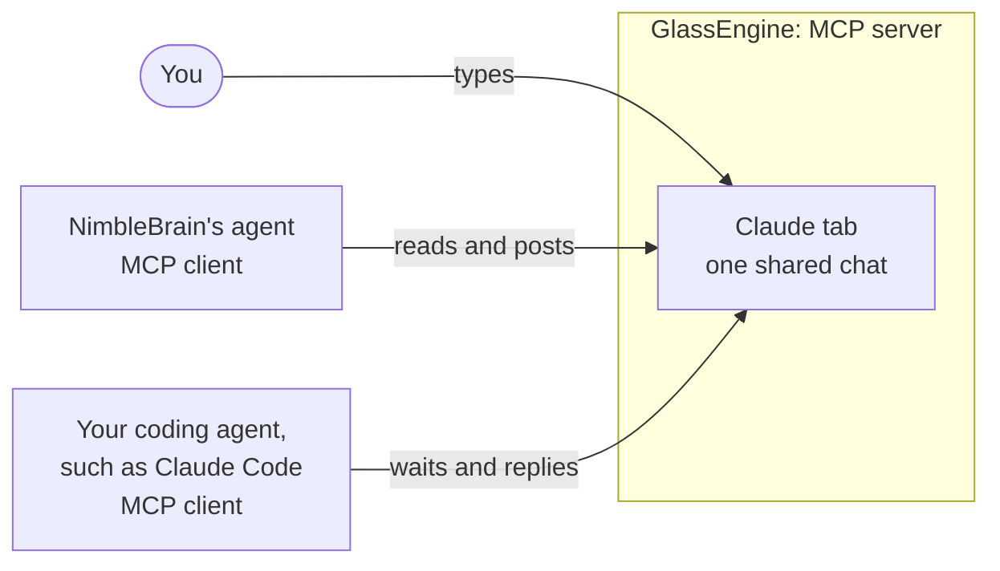

# GlassEngine

Your own coding agents as chat tabs inside NimbleBrain.

You may already use an AI helper on your computer, such as Claude Code. GlassEngine gives that
helper a chat window inside NimbleBrain. You type there and your helper answers there. NimbleBrain's
own assistant can read the same conversation and add to it. Both assistants connect through MCP, a
standard way for AI tools to talk to each other. GlassEngine sits in the middle and holds the chat.



GlassEngine is one small MCP server with an MCP App view, running on your machine at
`http://127.0.0.1:27281/mcp`. Two kinds of clients connect to it:

- **NimbleBrain**, as a workspace connector. The GlassEngine screen appears under **Apps**, and
  NimbleBrain's agent gets tools to list the tabs, read each chat and post into it.
- **Your coding agents**, such as Claude Code. An agent joins its platform's tab, waits for
  messages, and answers in the same chat.

The screen has one tab per platform: **Claude**, **Codex** and **Other**. When your Claude Code
session joins, the Claude tab becomes a chat with it. You type in the tab, NimbleBrain's agent can
read the same chat and post into it, and Claude's answers show up for both of you.

Every button and switch on the screen calls a GlassEngine tool. The screen re-reads the server
after each one, so what you see is what the server holds.

## Run

Needs [Bun](https://bun.sh) 1.2 or newer and a NimbleBrain checkout with its root dependencies
installed (`bun install --frozen-lockfile` at the repository root). GlassEngine uses only packages
NimbleBrain already depends on, so it has no install step of its own.

```bash
cd examples/glassengine
bun run start
```

It listens on `127.0.0.1:27281` (set `PORT` to change it) and prints two things you need next: the
Claude Code command and the connector entry for NimbleBrain.

| Variable | Default | What it sets |
|---|---|---|
| `PORT` | `27281` | The port GlassEngine listens on. |
| `GLASSENGINE_CONFIG` | `glassengine.config.json`, else the example file | Lease length and optional engines (see [Configured engines](#configured-engines)). |
| `GLASSENGINE_DATA` | `.glassengine/` | The chat transcript, the switches you set on screen, and the connector token. |
| `GLASSENGINE_TOKEN` | a random token kept in the data folder | The token in NimbleBrain's connector entry. |

`bun test` runs the tests; no agent, key or network is needed.

## Connect to NimbleBrain

These steps add GlassEngine to a local NimbleBrain started with `bun run dev` (API on `27247`,
web on `27246`). `<workDir>` is `~/.nimblebrain` unless you set `NB_WORK_DIR`.

1. **Find your workspace id.** Open NimbleBrain, go to **Workspace settings → MCP**, and copy the
   Server URL shown there; its last part is the `ws_…` id. Or list the folder:
   `ls <workDir>/workspaces`.
2. **Stop NimbleBrain** (Ctrl+C in the terminal running `bun run dev`). NimbleBrain reads the
   files below only when it starts.
3. **Allow a local connector.** In `<workDir>/nimblebrain.json`, add
   `"allowInsecureRemotes": true`. This development setting lets NimbleBrain reach a connector
   served over plain HTTP on your own machine.
4. **Add the connector.** Append the entry GlassEngine printed to the `connectors` array in
   `<workDir>/workspaces/<wsId>/workspace.json`. It looks like this, with your own token:

   ```json
   {
     "url": "http://127.0.0.1:27281/mcp",
     "serverName": "glassengine",
     "transport": {
       "type": "streamable-http",
       "auth": { "type": "bearer", "token": "<token GlassEngine printed>" }
     },
     "ui": {
       "placements": [
         {
           "slot": "sidebar.apps",
           "resourceUri": "ui://glassengine/main",
           "route": "glassengine",
           "label": "GlassEngine"
         }
       ]
     }
   }
   ```

5. **Start NimbleBrain again** with GlassEngine still running. The API log shows
   `✓ glassengine ready (10 tools, remote)`, and **GlassEngine** appears under **Apps**.

NimbleBrain keeps the screen's own controls (send box, Disconnect, Hand over, settings) out of every
agent's tool list, so those stay yours. A coding agent added with the command below sees only the
tools for joining a tab.

## Connect Claude Code

If you installed the NimbleBrain plugin for Claude Code, this connection is already in place; skip
to [Join](#join). Otherwise, run this once in a terminal:

```bash
claude mcp add --transport http --scope user glassengine http://127.0.0.1:27281/mcp
```

`--scope user` makes GlassEngine available in every folder and in the Claude desktop app's Code
tab. Start a new session afterwards; a running session does not pick up a new server.
`claude mcp get glassengine` shows `Status: ✔ Connected` while GlassEngine is running.

## Join

In the Claude Code session, say:

> join GlassEngine as claude and keep answering

With the plugin, `/nimblebrain:glass-join` does the same. Claude calls `join`, then loops: `wait_for_message`, answer with `reply`, wait again. Each wait
returns within 50 seconds, with a message or with "no message yet", and Claude calls it again.
Claude Code asks before each tool call until you allow the GlassEngine tools. Allow them once for
the session so the loop runs without stopping.

Now type in the **Claude** tab of GlassEngine. Claude gets the message on its next wait and its
answer appears in the tab. NimbleBrain's agent can do the same: ask it to "post in the Claude tab
of GlassEngine" or to "read what Claude said in GlassEngine".

## The tab

| On screen | Tool | What it does |
|---|---|---|
| Status: Connected, Away, Not connected | `list_tabs`, `get_glass` | The tools report `live`, `away` and `not joined`. Connected while the session waits or has waited within the last two minutes; Away once that lapses. A configured engine shows Ready, Answering… or Can't start (`idle`, `busy`, `unavailable`). |
| Send box | `person_send` | Writes into the chat. Messages sent while nobody is joined wait for the next session. |
| Pause / Resume | `pause`, `resume` | Pause holds messages; the agent's waits return "no message yet" until you resume. |
| Disconnect | `release_tab` | Ends the joined session. |
| Hand over | `hand_over` | Shown when a second session of the same platform asked to join. Ends the current session so the new one can join. |
| What's allowed | `set_policy` | The settings below. |

**One session per platform.** Only one Claude session can hold the Claude tab at a time, and the
same for Codex and Other. Each wait renews the session's lease. A second session that tries to
join is refused with a plain message until you press **Hand over**, or until about two minutes
pass without a wait from the first one (the tab then shows Away). Two sessions never answer one
chat.

**What's allowed**, per tab:

| On screen | Key | Default | Meaning |
|---|---|---|---|
| NimbleBrain's agent can send messages here | `agentsMaySend` | on (off for a configured engine) | Agents in the workspace may post into this chat with `send_message`. |
| NimbleBrain's agent can read this chat | `agentsMayRead` | on | Agents may read it with `read_transcript`. You and the joined agent always can. |
| Claude can change these settings | `joinedMayChangePolicy` | off | Lets the joined agent call `set_policy` for its own tab. |

**Words for people, detail for agents.** Everything on the screen is written for you: no tool
names, session ids or settings keys. Agents get the precise version. Tool descriptions and results
name the tools and keys, and every GlassEngine line in the chat carries a `detail` field (shown in
brackets by `read_transcript`) that says which tool or setting caused it.

The joined agent controls only its own chat, its status and, if you allow it, its own tab's
settings. It cannot add tabs or engines. GlassEngine shows what is said in the tab; tool calls the
agent makes elsewhere (in your files, or in NimbleBrain through other connections) are not
mirrored here.

## Tools

For a joined agent:

| Tool | What it does |
|---|---|
| `join` | Join the tab for a platform: `claude`, `codex` or `other`. Returns a session id. |
| `wait_for_message` | Wait up to `timeoutSeconds` (default 45, at most 50) for messages; renews the lease. |
| `reply` | Write into the tab's chat. |
| `set_status` | Show `working`, `waiting`, `done` or `blocked`, with an optional note. |
| `read_transcript` | Read the tab's chat. |
| `release` | Leave the tab. |
| `set_policy` | Change one of the tab's switches, when the person allows it. |

For NimbleBrain:

| Tool | Who sees it | What it does |
|---|---|---|
| `list_tabs` | agents, the screen | Tabs, who is joined, status, held messages, switches. |
| `read_transcript` | agents | A tab's chat, or every tab agents may read. |
| `send_message` | agents | Post into a tab as NimbleBrain's agent. |
| `pause`, `resume` | agents, the screen | Hold or release a tab's messages. |
| `get_glass`, `person_send`, `release_tab`, `hand_over`, `set_policy` | the screen | The screen's own read, send box, buttons and switches. |

## Configured engines

An agent that cannot stay in a session can still get a tab: GlassEngine runs it once per message.
These engines live **only** in the config file; no tool adds, changes or removes one. Copy the
example, edit it, and restart GlassEngine; your copy is ignored by git.

```bash
cp glassengine.config.example.json glassengine.config.json
```

Agents may not post to a configured engine until you switch that on in its tab, because each
message runs it.

- **`echo`** answers with the message itself; `delayMs` makes it look busy for a moment.

  ```json
  { "id": "echo", "adapter": { "kind": "echo", "delayMs": 1500 } }
  ```

- **`command`** runs a program once per message and takes what it prints as the reply. The program
  starts directly, never through a shell. `prompt` is `"stdin"` (default) or `"argument"`. `cwd`
  is relative to the config file or starts with `~/`. The program gets `GLASSENGINE_ENGINE` and
  `GLASSENGINE_TURN` in its environment. `timeoutSeconds` defaults to 600.

  ```json
  {
    "id": "summarizer",
    "adapter": { "kind": "command", "command": ["./summarize.sh"], "prompt": "stdin" }
  }
  ```

- **`http`** POSTs `{"prompt", "engine", "turn"}` as JSON to a local endpoint and takes the reply
  from the `replyField` of a JSON body (default `reply`) or from a text body. `tokenEnv` names an
  environment variable sent as a bearer token.

  ```json
  { "id": "my-agent", "adapter": { "kind": "http", "url": "http://127.0.0.1:8080/chat" } }
  ```

An engine id must not be `claude`, `codex` or `other`. `leaseSeconds` (default 120) sets how long a
joined session stays live after its last wait.

## Codex and other agents

This example is tested on macOS with Claude Code. Codex is next and not yet tested end to end.
Any agent that speaks MCP over Streamable HTTP can join the same way, as `codex` or `other`:

1. Add `http://127.0.0.1:27281/mcp` as an MCP server in the agent's configuration. For Codex, the
   NimbleBrain plugin for Codex adds it, or run
   `codex mcp add glassengine --url http://127.0.0.1:27281/mcp`.
2. Start a new session.
3. Ask it to "join GlassEngine as codex and keep answering".

GlassEngine accepts the 2025 MCP protocol versions that Codex speaks, so Codex needs no feature
flag to reach it.

## Limits

- **The agent's session must stay open.** The chat works while the joined session keeps calling
  `wait_for_message`. Close the session, or let it finish its turn, and the tab shows Away about
  two minutes later; messages wait for the next session.
- **Its context grows.** Every message and reply becomes part of the agent's conversation, so a
  long chat fills its context window; the agent's own compaction applies. Start a fresh session
  and join again when it gets long.
- **One machine.** GlassEngine, NimbleBrain and the agents all run on the same computer; every
  address here is `127.0.0.1` or `localhost`. Local NimbleBrain in dev mode has no login.
- **Chat only.** Each tab shows what is said in it; it does not mirror the agent's other tool
  calls.

## Files

```
examples/glassengine/
  glassengine.config.example.json   lease length, no engines
  src/main.ts                       start: config, data folder, token, server
  src/config.ts                     platforms and the config file
  src/policy.ts                     the switches
  src/glass.ts                      tabs, sessions and leases, the chat, pause and hand over
  src/adapters.ts                   echo, command and http engines
  src/store.ts                      transcript and switches on disk
  src/server.ts                     the two sets of MCP tools, the ui:// view, HTTP
  src/ui.ts                         bundles the view into one HTML document
  ui/                               the GlassEngine screen
  test/                             bun test
```
