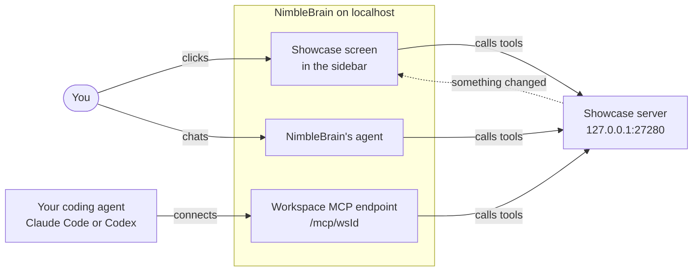

# Showcase

The showcase is a hands-on tour of what NimbleBrain can do with an MCP App. An MCP App is a tool
server that also ships its own screens: NimbleBrain shows the screens, and its agent calls the same
tools.

Run the showcase next to a local NimbleBrain and you get a sidebar app with eight panels. Each panel
shows one capability and names the tools it calls, so you can watch the screen and the agent share
the same work. When you want to build your own app, copy this folder.

| Panel | What it shows | Tools it calls |
|---|---|---|
| Setup | A checklist your agent works through while you watch: name, timezone, theme, model, GlassEngine, then a first look at each panel | `get_setup_checklist`, `start_setup_step`, `complete_setup_step`, `skip_setup_step`, `show_panel`, `next_panel`, `reset_setup` |
| Tour | Ten steps through the panels below, with saved progress | `start_tour`, `save_tour_step` |
| Board | A task board behind tools. When the agent moves a card, the screen updates at once | `list_cards`, `add_card`, `move_card` |
| Table | Sorting, filtering and paging, all as arguments to one read tool | `list_cards` |
| Chart | A chart drawn from a tool result, in your light or dark theme | `board_stats` |
| Bridge | Things only NimbleBrain can do for an app: show a notice, post a chat message, give the agent context, save a file, open a link or another page | `export_cards` |
| Server | What the agent sees, the tools only the screen can use, the server instructions and the published skill | `describe_server` |
| Placements | One server filling a sidebar entry and two full pages | `describe_server` |

The board holds made-up sample cards, kept in memory. Restart the server or call `reset_board` to get
the starting cards back. The showcase never calls a model, so every panel works without a provider
key. Asking the chat to change the board does need one.

## How it fits

The showcase runs as its own small server on your machine. NimbleBrain adds it to a workspace as a
connector, which is a tool server the workspace can call. Three things then drive the same tools:
you clicking on the screen, NimbleBrain's agent in the chat, and your own coding agent through the
workspace's MCP endpoint. A change from any of them shows up on screen at once.



## Run

You need [Bun](https://bun.sh) 1.2 or newer.

```bash
cd examples/showcase
bun install
bun run start
```

The server listens on `http://127.0.0.1:27280/mcp`. Set `PORT` to use another port. Set
`SHOWCASE_TOKEN` to require `Authorization: Bearer <token>` on every request. The connector entry
below sends `local-showcase`, so start the server with that token:

```bash
SHOWCASE_TOKEN=local-showcase bun run start
```

## Connect to NimbleBrain

These steps add the showcase to NimbleBrain running from source on the same machine, as the
repository's README describes. Dev mode has no login, so run it only on a machine you trust. The
commands use the default ports: 27247 for the API and 27246 for the web app. Use yours if you changed
them.

1. Find the workspace id and the work directory. The id is in the bootstrap response:

   ```bash
   curl -s http://localhost:27247/v1/bootstrap | grep -o '"id":"ws_[0-9a-f]*"'
   ```

   The work directory is where NimbleBrain keeps its files. It is the first of these that applies:
   `NB_WORK_DIR` if you set it; `.nimblebrain/` in the folder you start NimbleBrain from, if it
   exists; `.nimblebrain-worktree/` in the checkout, for `bun run dev:worktree`; otherwise
   `~/.nimblebrain`.

2. Let the workspace reach a server on this machine over plain HTTP. In
   `<workDir>/nimblebrain.json`, add:

   ```json
   { "allowInsecureRemotes": true }
   ```

   This is a development setting. Leave it off on a deployed instance.

3. Add the connector to the `connectors` array in `<workDir>/workspaces/<wsId>/workspace.json`:

   ```json
   {
     "url": "http://127.0.0.1:27280/mcp",
     "serverName": "showcase",
     "transport": {
       "type": "streamable-http",
       "auth": { "type": "bearer", "token": "local-showcase" }
     },
     "ui": {
       "placements": [
         { "slot": "sidebar.apps", "resourceUri": "ui://showcase/app", "route": "showcase", "label": "Showcase", "priority": 20 },
         { "slot": "main", "resourceUri": "ui://showcase/tour", "route": "showcase/tour", "label": "Showcase tour" },
         { "slot": "main", "resourceUri": "ui://showcase/table", "route": "showcase/table", "label": "Showcase table" }
       ]
     }
   }
   ```

   NimbleBrain starts a URL connector at load time only if it holds credentials for it, so the
   entry carries a bearer token. The agent sees the tools as `showcase__<tool>`.

4. In `examples/showcase`, start the showcase with `SHOWCASE_TOKEN=local-showcase bun run start`.
   Then restart NimbleBrain, which reads `workspace.json` only when it starts. Its log then shows a
   line ending in `✓ showcase ready (16 tools, remote)`.

5. Open NimbleBrain at `http://localhost:27246`. Click **Showcase** under Apps in the sidebar, or
   ask the chat to "start the showcase tour".

### Check it from a terminal

The workspace MCP endpoint lists the tools the agent can see. Tools only the screen can use are
left out:

```bash
WS=<your workspace id>
curl -s -X POST "http://localhost:27247/mcp/$WS" \
  -H 'Content-Type: application/json' -H 'Accept: application/json, text/event-stream' \
  -H 'MCP-Protocol-Version: 2026-07-28' -H 'Mcp-Method: tools/list' \
  -d '{"jsonrpc":"2.0","id":1,"method":"tools/list","params":{"_meta":{
        "io.modelcontextprotocol/protocolVersion":"2026-07-28",
        "io.modelcontextprotocol/clientInfo":{"name":"curl","version":"0"},
        "io.modelcontextprotocol/clientCapabilities":{}}}}' \
  | grep -o '"name":"showcase__[a-z_]*"'
```

The page NimbleBrain shows in the sidebar comes from the same server:

```bash
curl -s "http://localhost:27247/v1/workspaces/$WS/apps/showcase/resources/app" | head -c 300
```

## Let your agent set you up

The Setup panel is a twelve-step checklist. Your agent works through it while you watch. Each step
is a tool with an effect you can see, and every button on screen calls the same tool, so you can
take over at any point. The showcase only records progress and moves the screen. NimbleBrain's own
tools make the changes.

| Step | What your agent does | NimbleBrain call |
|---|---|---|
| name, timezone, theme | Asks you, then saves it. A new theme applies at once | `nb__set_preferences` |
| model (optional) | Asks which model new conversations use | `nb__set_preferences` with `model` |
| glassengine (optional) | Asks whether to show your own agent in a tab | a second connector |
| first look, seven steps | Opens each panel and says what it shows | `show_panel`, `next_panel` |

Connect your agent to the workspace endpoint, `http://localhost:27247/mcp/<wsId>` (use your own
port), and tell it: "set up NimbleBrain with the showcase". The setup skill's
[connect-agents page](../../.agents/skills/nimblebrain-setup/references/connect-agents.md) has the
exact command for Claude Code and Codex. NimbleBrain's agent runs the same checklist when you say
"set me up" in the chat. For each step, the agent:

1. Calls `showcase__get_setup_checklist` for the steps, their status and the call to make.
2. Calls `showcase__start_setup_step`. The step turns "in progress" and its panel opens.
3. Makes the change, for example `nb__set_preferences {"timezone": "Europe/Lisbon"}`.
4. Calls `showcase__complete_setup_step` with a short note, or `showcase__skip_setup_step` for an
   optional step. Notes show on screen, so they never hold keys or secrets.

Any MCP client works. To make a raw call, take the request in "Check it from a terminal" and swap in
`tools/call` with `{"name": "showcase__start_setup_step", "arguments": {"step": "name"}}`.
Progress lives in memory and starts over when the showcase restarts. `reset_setup` clears the
checklist and leaves your NimbleBrain settings alone.

## Start the tour

Ask the chat to "start the showcase tour". The agent calls `start_tour`, and the tour appears in its
answer. Without a provider key, open **Showcase** from the sidebar instead; the Setup panel comes
first.

## How it is built

| File | What it holds |
|---|---|
| `src/server.ts` | The entry point: the HTTP server on 127.0.0.1, and the change notice after every write |
| `src/mcp.ts` | Tools, `ui://` pages, the skills listing and the server instructions |
| `src/board.ts` | The sample board |
| `src/tour.ts` | The tour steps and progress |
| `src/setup.ts` | The setup checklist and which panel is showing |
| `src/skills.ts` | Serves `skills/` over the MCP skills extension |
| `src/ui.ts` | Builds each page from `ui/` and NimbleBrain's Synapse SDK, inlined into one document |
| `ui/` | The page: plain HTML, CSS and JavaScript, with no build step |
| `skills/showcase-guide/SKILL.md` | Guidance for NimbleBrain's agent, tied to this server's tools |

What to know when you build your own app from it:

- **Live sync.** After any write, the server sends `notifications/resources/list_changed`.
  NimbleBrain passes it to every open copy of the server's screens, and each one re-reads its data.
  A screen does not redraw after its own write; the notice does that for every copy at once.
- **App-only tools.** A tool with `_meta.ui.visibility: ["app"]` is for the screen. The screen can
  call it. NimbleBrain hides it from every tool list an agent sees and refuses an agent that calls
  it.
- **Guidance.** The server declares the `io.modelcontextprotocol/skills` extension and lists
  `skills/showcase-guide`. The skill has no `tool-affinity` in its frontmatter, so NimbleBrain ties
  it to all of this server's tools and gives it to the agent before the agent first calls one.
- **Pages.** A `ui://` resource with MIME type `text/html;profile=mcp-app` is a whole page.
  NimbleBrain loads it into a sandboxed frame, so the page must be one self-contained document. It
  uses buttons, not form submits.
- **Placements.** The `ui.placements` list in the connector entry decides where pages appear. All
  placements of one connector share one `ui://` authority, here `showcase`.

To start your own app, copy this folder, change `serverName` and the `ui://` authority, and replace
the board with your own data.

## Test

```bash
bun test
```

The tests run the MCP server in process, with no port. They cover the board and tour, the skills
listing, `tools/list` and `tools/call`, the pages, and the request checks. This folder is its own
package, so the repository's `bun run verify` does not build or test it.
